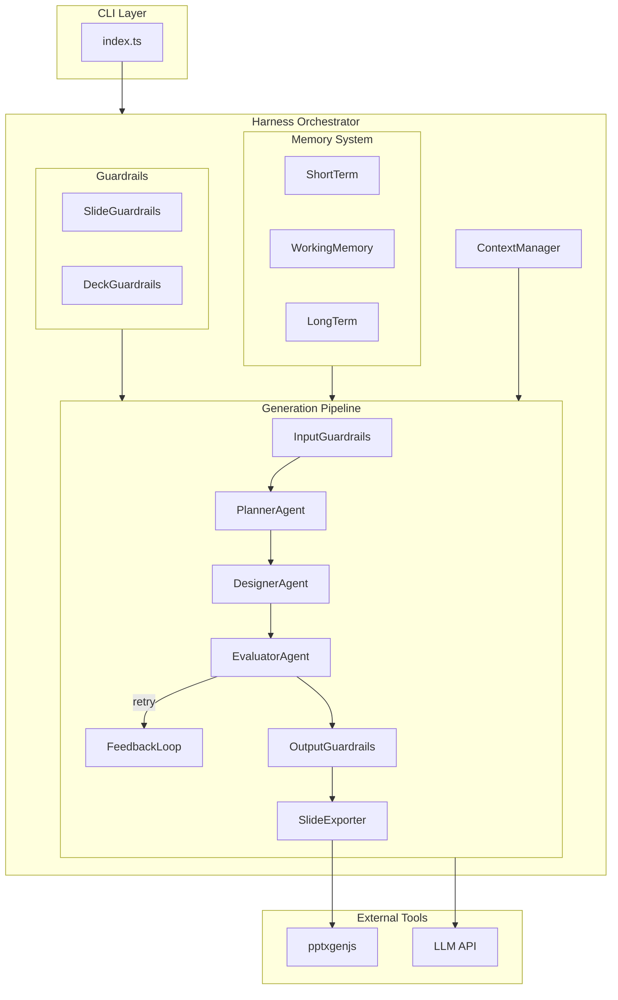
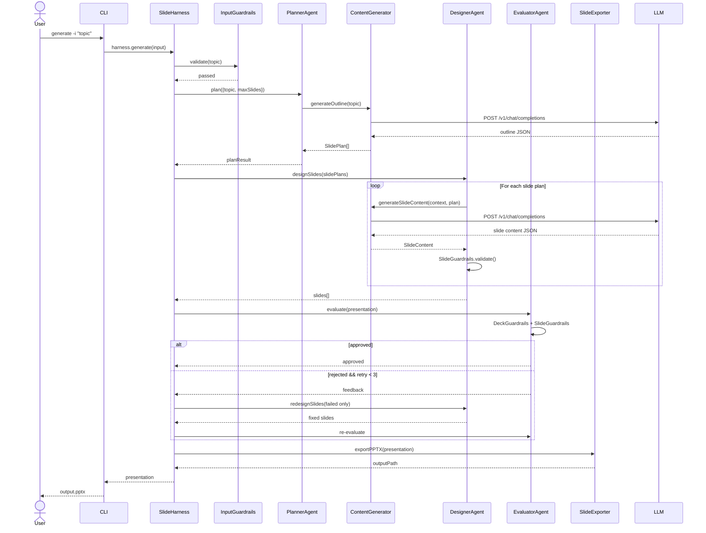
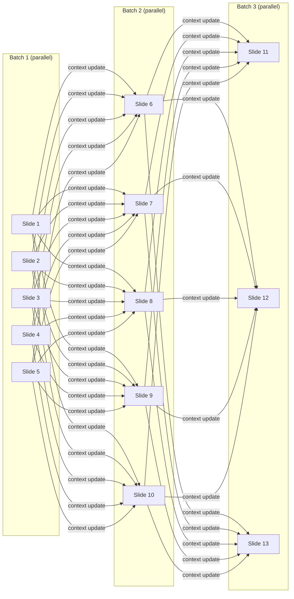
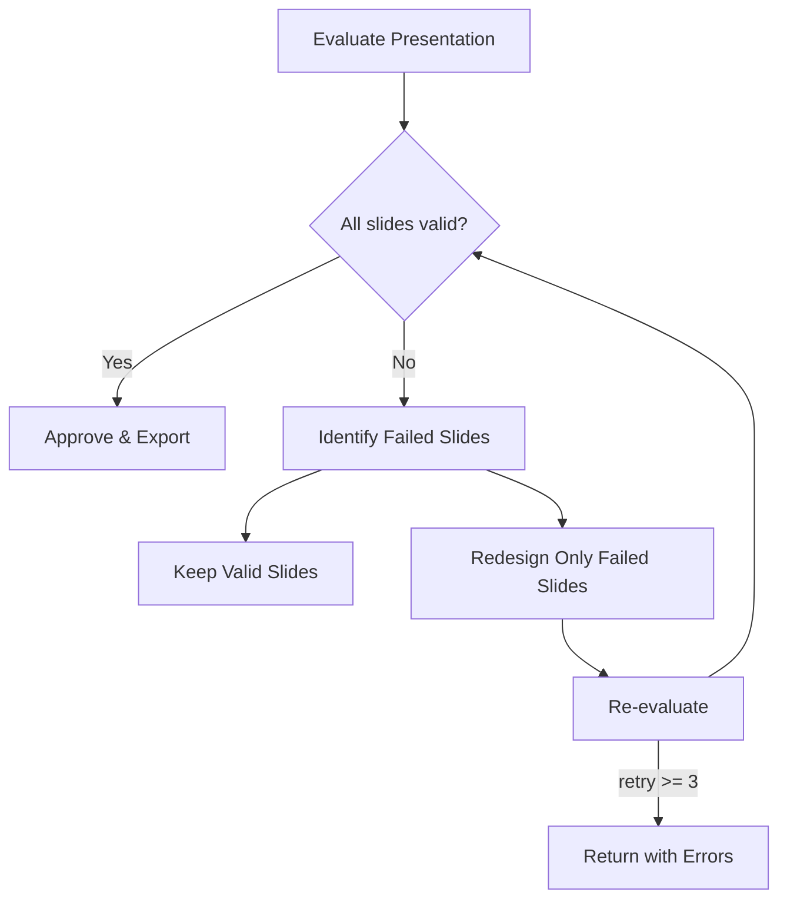

# Performance Improvement Plan

## Current Bottlenecks

### 1. Sequential Slide Design (80% of latency)
File: `designerAgent.ts:40` - Each slide generated one at a time in a for-loop.
20 slides x 3-5s = 60-100s just for design phase.

### 2. Sequential Chunk Outline (15% of latency for long content)
File: `contentGenerator.ts:103` - Each chunk processed one at a time.

### 3. Full Redesign on Retry
File: `harness/index.ts:222` - ALL slides regenerated even if only 1-2 failed.

### 4. No Streaming
File: `contentGenerator.ts:270` - `stream: false`, no progressive feedback.

---

## Improvement Phases

### Phase 1: Parallel Slide Design (P0 - Highest Priority)
File: `src/agents/designerAgent.ts`

Split slides into batches (size 5), generate within each batch in parallel using `Promise.allSettled`. Between batches, update context window.

**Expected: 4-5x faster**

### Phase 2: Parallel Chunk Outline (P0)
File: `src/harness/tools/contentGenerator.ts`

Process all chunks simultaneously with `Promise.allSettled`.

**Expected: 5-10x faster** for outline generation

### Phase 3: Smart Retry with Partial Redesign (P1)
Files: `src/harness/index.ts`, `src/agents/designerAgent.ts`

Only regenerate failed slides. Keep valid slides intact. Pass failed indices and error feedback.

**Expected: 50-70% faster retries**

### Phase 4: Concurrency Control & Progress (P1)
New file: `src/utils/concurrency.ts`

Semaphore-based concurrency pool with configurable limit + progress callbacks.

### Phase 5: Response Caching (P2)
New file: `src/harness/memory/cache.ts`

Cache LLM responses by content hash with TTL expiry.

### Phase 6: Streaming Support (P2)
File: `src/harness/tools/contentGenerator.ts`

Enable `stream: true`, parse SSE incrementally for progressive content.

---

## Expected Results

| Scenario | Current | After | Speedup |
|----------|---------|-------|---------|
| 10 slides | ~35s | ~8s | 4.4x |
| 20 slides | ~65s | ~15s | 4.3x |
| 30 slides (long) | ~120s | ~25s | 4.8x |
| Retry (any) | 2-3x | 1.2-1.5x | ~2x |

## Additional Advanced Techniques

### Phase 7: Worker Threads for CPU-Bound Tasks (P2)
New file: `src/utils/workerPool.ts`

Sử dụng `worker_threads` cho các task CPU-intensive, tránh block main thread event loop:
- **PPTX generation** (pptxgenjs) — serialize/render slides rất nặng CPU
- **JSON parsing** lớn từ LLM response
- **Text chunking** trên document >100KB

```typescript
// Worker pool pattern
import { Worker } from 'worker_threads';

export class WorkerPool {
  private queue: { task: any; resolve: Function }[] = [];
  private workers: Worker[] = [];
  
  async run<T>(task: any): Promise<T> {
    // Dispatch task to available worker
    // Auto-scale workers based on CPU cores
  }
}

// Usage: offload PPTX generation to worker
const pptx = await workerPool.run({ type: 'export-pptx', slides, theme });
```

> **Lưu ý**: Node.js Worker Threads chỉ hữu ích cho CPU-bound tasks. I/O-bound tasks (LLM API calls) đã được xử lý tốt bằng Promise/async-await. Dùng worker cho LLM calls là waste resources.

---

### Phase 8: HTTP Connection Pooling & Keep-Alive (P1)
File: `src/harness/tools/contentGenerator.ts`

Mỗi LLM call hiện tại có thể tạo TCP connection mới. Sử dụng `undici` (built-in Node.js 18+) hoặc global `Agent` để reuse connections:

```typescript
import { Agent, setGlobalDispatcher } from 'undici';

// Reuse connections to LLM endpoint
const agent = new Agent({
  keepAliveTimeout: 30_000,
  connections: 10,  // Max concurrent connections
  pipelining: 1,
});
setGlobalDispatcher(agent);
```

**Impact**: Giảm ~100-300ms per request do tránh TCP handshake + TLS negotiation lại.

---

### Phase 9: Circuit Breaker Pattern (P2)
New file: `src/utils/circuitBreaker.ts`

Tránh cascading failures khi LLM endpoint down. Tự động chuyển sang fallback model nhanh hơn:

```typescript
export class CircuitBreaker {
  private failures = 0;
  private state: 'closed' | 'open' | 'half-open' = 'closed';
  private lastFailure = 0;
  
  async execute<T>(fn: () => Promise<T>, fallback: () => Promise<T>): Promise<T> {
    if (this.state === 'open' && Date.now() - this.lastFailure < this.resetTimeout) {
      return fallback(); // Skip to fallback immediately
    }
    try {
      const result = await fn();
      this.onSuccess();
      return result;
    } catch (e) {
      this.onFailure();
      return fallback();
    }
  }
}
```

**Impact**: Khi LLM down, thay vì chờ timeout từng request → failover tức thì.

---

### Phase 10: Adaptive Concurrency (P2)
File: `src/utils/concurrency.ts`

Tự động điều chỉnh concurrency dựa trên response latency thực tế:

```typescript
export class AdaptiveConcurrency {
  private concurrency = 5;  // Start conservative
  private avgLatency = 0;
  
  onResponse(latencyMs: number) {
    this.avgLatency = (this.avgLatency + latencyMs) / 2;
    if (this.avgLatency < 2000) this.concurrency = Math.min(this.concurrency + 1, 10);
    else if (this.avgLatency > 5000) this.concurrency = Math.max(this.concurrency - 1, 2);
  }
}
```

**Impact**: Tối ưu throughput theo thời gian thực, tránh overwhelming LLM server.

---

### Phase 11: Request Coalescing / Deduplication (P2)
New file: `src/utils/requestCoalescer.ts`

Nhiều slide có thể request content gần giống nhau. Merge các request giống nhau thành 1 LLM call:

```typescript
export class RequestCoalescer {
  private pending = new Map<string, Promise<any>>();
  
  async deduplicate<T>(key: string, fn: () => Promise<T>): Promise<T> {
    if (this.pending.has(key)) {
      return this.pending.get(key)!; // Reuse in-flight request
    }
    const promise = fn().finally(() => this.pending.delete(key));
    this.pending.set(key, promise);
    return promise;
  }
}
```

**Impact**: Tránh duplicate LLM calls cho slides có outline giống nhau.

---

### Phase 12: Parallel Validation (P1)
File: `src/harness/guardrails/slideGuardrails.ts`

Hiện tại `validateSlides()` chạy tuần tự. Chuyển sang song song:

```typescript
async validateSlides(slides: Slide[]) {
  const results = await Promise.all(
    slides.map(slide => this.validateSlide(slide))
  );
  return { allPassed: results.every(r => r.passed), results };
}
```

---

### Phase 13: Background Export with Pipeline (P1)
File: `src/harness/index.ts`

Bắt đầu export PPTX ngay khi có đủ slides, không cần chờ evaluation hoàn tất:

```typescript
// Pipeline pattern: design → validate → export concurrently
const exportPromise = this.slideExporter.prepareTemplate(theme);
// ... design slides ...
const validatePromise = this.evaluatorAgent.evaluate(presentation);
// Apply minor fixes while export is preparing
await validatePromise;
const outputPath = await this.slideExporter.finalize(exportPromise, presentation);
```

---

## Summary: Complete Phase List

| Phase | Technique | Type | Priority | Expected Impact |
|-------|-----------|------|----------|-----------------|
| 1 | Parallel Slide Design (batch) | I/O Parallel | P0 | 4-5x faster |
| 2 | Parallel Chunk Outline | I/O Parallel | P0 | 5-10x faster |
| 3 | Smart Partial Retry | Algorithm | P1 | 50-70% faster retry |
| 4 | Concurrency Pool + Progress | Infrastructure | P1 | Load control |
| 5 | Response Caching | Cache | P2 | Avoid redundant calls |
| 6 | Streaming Support | UX | P2 | Perceived performance |
| 7 | Worker Threads (CPU tasks) | CPU Parallel | P2 | Non-blocking export |
| 8 | HTTP Connection Pooling | Network | P1 | 100-300ms saved/request |
| 9 | Circuit Breaker | Resilience | P2 | Fast failover |
| 10 | Adaptive Concurrency | Optimization | P2 | Auto-tune throughput |
| 11 | Request Coalescing | Dedup | P2 | Avoid duplicate calls |
| 12 | Parallel Validation | I/O Parallel | P1 | ~2x faster validation |
| 13 | Background Export Pipeline | Pipeline | P1 | Overlap I/O + CPU |

---

### Phase 14: README.md with Mermaid Architecture Diagrams (P1)
File: `README.md`

Cập nhật toàn bộ section Kiến Trúc và Flow từ ASCII art sang **Mermaid diagrams**:

#### 14a. System Architecture Diagram (C4-style)


#### 14b. Generation Flow (Sequence Diagram)


#### 14c. Parallel Slide Design Flow (Batches)


#### 14d. Smart Retry Flow


**Impact**: Documentation quality大幅提高, developer onboarding更快, architecture visualization更清晰.

---

## Files to Modify / Create

| File | Changes |
|------|---------|
| `src/agents/designerAgent.ts` | Phase 1: Batch parallel slide generation |
| `src/harness/tools/contentGenerator.ts` | Phase 2: Parallel chunks, Phase 6: Streaming, Phase 8: Keep-Alive |
| `src/harness/index.ts` | Phase 3: Smart retry, Phase 13: Pipeline export |
| `src/harness/guardrails/slideGuardrails.ts` | Phase 12: Parallel validation |
| `README.md` | **Phase 14**: Mermaid architecture + flow diagrams |
| `src/utils/concurrency.ts` | **NEW** — Phase 4+10: Adaptive concurrency pool |
| `src/utils/circuitBreaker.ts` | **NEW** — Phase 9: Circuit breaker |
| `src/utils/requestCoalescer.ts` | **NEW** — Phase 11: Request dedup |
| `src/utils/workerPool.ts` | **NEW** — Phase 7: Worker thread pool |
| `src/harness/memory/cache.ts` | **NEW** — Phase 5: Response cache |
